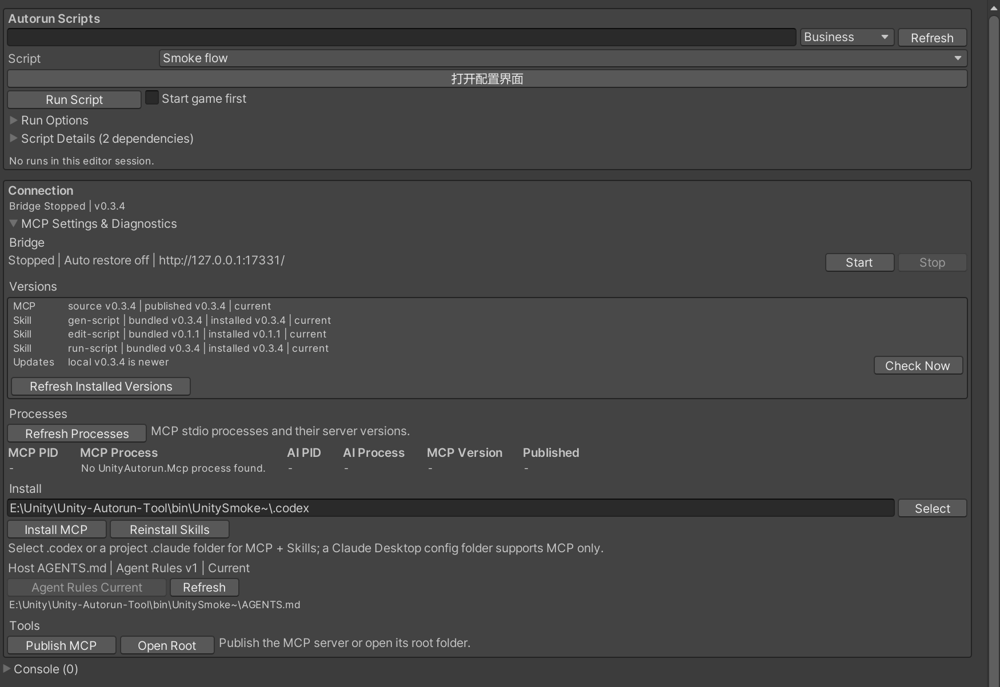
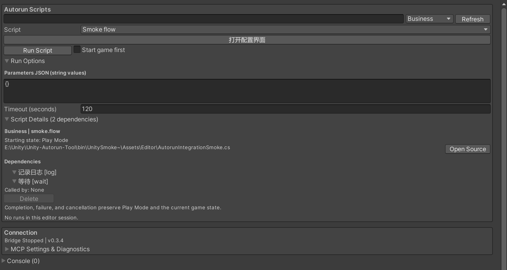
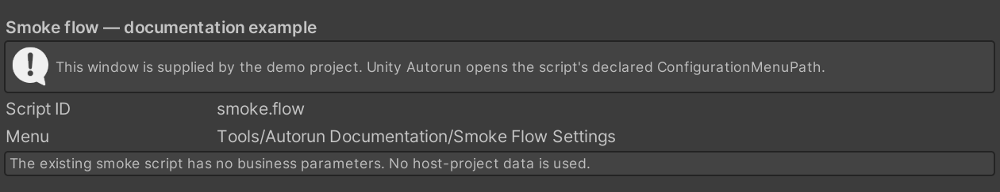

# Unity Autorun Tool

[中文（默认）](./README.md) | [English](./README_EN.md)

Unity Autorun Tool 是一个 Unity Editor 自动化工具。外部 AI 根据宿主项目源码与运行时证据生成可复用的 C# 业务脚本，Unity 负责编译并执行，MCP 提供脚本管理、运行状态、UIState 和基础交互能力。

## 近期更新（0.3.x）

当前包版本为 **0.3.4**，工作流已经统一为可编译、可检查起点和断言的 C# 脚本。

- 三个独立 Skill 分别负责生成并自测、维护已有脚本和执行：`gen-script`、`edit-script`、`run-script`；可将“自测先检查已有脚本”的规则安装到宿主 `AGENTS.md`。
- 脚本面板集中展示运行入口、步骤日志与结果；冷启动脚本声明 `PreparePlayMode=true` 后可直接 `Start Game & Run`，结束或失败保留游戏现场。
- 脚本可声明宿主配置菜单，在面板中提供“打开配置界面”入口，方便运行前检查业务配置。
- 默认运行截图存放在工具的临时目录，后续默认截图会清理过期和超量文件；需要长期保留的证据可显式指定保存路径。

## 快速安装

需要 Unity 2021.3 或更新版本、[Git](https://git-scm.com/downloads) 和 [.NET 8 SDK](https://dotnet.microsoft.com/zh-cn/download/dotnet/8.0)。

1. 在 Unity 中打开 `Window > Package Manager`。
2. 点击 `+ > Add package from git URL...`，输入：

   ```text
   https://github.com/SHW2002/Unity-Autorun-MCP.git
   ```

3. 等待包导入和编译完成，打开 `Window > Auto Run Window`。
4. 展开 `Connection > MCP Settings & Diagnostics`，在 `Tools` 点击 `Publish MCP`，生成当前 MCP Server。
5. 在展开区的 `Install` 点击 `Select`，选择项目 `.codex` 或 Claude Code 项目 `.claude` 文件夹，依次点击 `Install MCP` 和 `Install Skills`。
6. 如需让 Agent 在游戏/UI 自测前优先检查已有脚本，在独立的 `Agent Rules` 行点击 `Install Agent Rules`，将提示规则写入当前宿主 Unity 项目根目录的 `AGENTS.md`。这一步与客户端目录和 `Install Skills` 分开。
7. 重新连接 AI 客户端，确认 `Bridge` 为 `Running`，`Processes` 显示对应 MCP 进程。`Versions` 分别展示 MCP、`gen-script`、`edit-script`、`run-script` 的版本和安装状态。

`Install Skills` 一次安装三个独立 Skill：Codex 安装到所选 `.codex` 同级的 `.agents/skills/`，Claude Code 安装到 `.claude/skills/`。安装器先验证并暂存整批文件，之后备份和替换；任一替换失败会回滚整批，已安装版本高于随包版本时拒绝覆盖。旧的 `unity-autorun` Skill 会保留并提示手动检查、卸载，避免删除用户定制内容。

Claude Desktop 只安装 MCP：选择包含 `claude_desktop_config.json` 的目录，点击 `Install MCP`。该客户端不会通过此目录加载本地文件系统 Skills。



## 从旧版升级

更新 Unity 包并等待编译后，重新 `Publish MCP`，在原客户端目标更新三个 Skills，再按需点击 `Update Agent Rules` 或 `Install Agent Rules`，重新连接客户端并核对各组件状态。包、MCP、Bridge 与各 Skill 独立展示版本，不要求版本号完全相同。

旧导航图、`gen-nav` 和手动 XML 导航入口已移除；安装器保留旧 `unity-autorun` Skill，需检查用户定制后手动卸载，避免旧提示继续调用已移除工具。已有导航数据、旧脚本目录和旧截图不会静默迁移或删除，新业务流程使用三个脚本 Skills。

## 宿主 Agent Rules 与自测选择

`Agent Rules` 行显示宿主 `AGENTS.md` 的 `Not installed`、`Update available`、`Current` 或读取/标记错误状态，可刷新检查。分别使用 `Install Agent Rules`、`Update Agent Rules` 写入规则；已一致时显示 `Agent Rules Current`。只有明确点击安装或更新才会写入宿主文件，客户端安装目录不会改变写入位置。

规则使用固定标记 `<!-- unity-autorun:agent-instructions:begin -->` 和 `<!-- unity-autorun:agent-instructions:end -->` 包围，并带有区块版本。文件或区块不存在时创建/追加；更新只替换这两个标记之间的管理区块，保留区块外的用户规则。重复标记、单侧缺失、顺序错误或更高版本会报告错误，不会覆盖文件。

规则要求 Agent 在需要游戏/UI 操作自测时，先通过 `list_scripts` 与 `get_script(includeSource=true)` 核对已有脚本的起点、完整流程、断言、参数和依赖。找到匹配且有效的脚本就直接用 `run-script` 执行；找不到时不得静默新建，可以询问是否需要创建自测脚本。用户已明确要求创建或调用 `gen-script` 时不重复确认。MCP、Unity 或 Bridge 无法调用属于检查阻塞，不能据此声称没有匹配脚本。起点不匹配或运行失败时保留现场并报告证据，不能自行改流程、弱化断言或重置游戏。

## 生成并自测脚本

```text
$gen-script 从启动游戏后的主界面打开背包，验证金币文本非空，并保存截图
```

`gen-script` 先明确起点、业务流程、参数与成功断言，检查已有业务脚本与基础脚本，再在宿主项目的 `Assets/Editor/AutorunScripts/` 中创建 C# 源文件。生成代码通过 Unity 编译后会运行自测，失败时默认最多三轮修正，修正范围仅限本次生成的代码。

旧目录 `Assets/AutorunScripts/Editor/` 的脚本仍可发现、读取和管理，新脚本统一生成到 Editor 目录。工具不会自动迁移已有文件；移动脚本时应通过 `AssetDatabase` 保留 `.meta` 和 GUID。

复用只允许完整一致的业务片段：起点、动作和结果都必须匹配。不能因为终点相同而复用不同流程，也不能为当前需求修改复用脚本。同一个目标的不同起点或不同流程使用独立脚本 ID 和文件。

每个业务脚本必须声明 `Preconditions` 并实现 `CheckPreconditions`。起点不符会在执行动作前失败，不会自动选择另一条流程。冷启动脚本在 attribute 中声明 `PreparePlayMode = true`，运行器会先进入 Play Mode，再检查实际场景/UI 起点；GUI 和 MCP 均无需额外勾选启动选项。脚本声明并调用 `start-play-mode` 基础脚本来复用准备校验步骤。普通脚本仍可由调用方显式选择 `ensurePlayMode=true`，其默认值保持 false；子脚本的准备声明不会隐式启动父流程或切换执行中的 Play Mode。

## 修改已有脚本

```text
$edit-script 修复 business.open-inventory 的金币文本读取，保持原有起点、背包打开流程和金币非空断言，编译自测并检查受影响的调用者
```

`edit-script` 读取指定的已有业务脚本、依赖和反向调用者，确认维护范围，检查 `unity_status.data.scriptRunStateAvailable=true`、`data.hasActiveScriptRun=false` 且 `data.isCompiling=false` 后才修改或刷新；已有运行、编译或暂不可用时等待，持续缺失/不可用时报告阻塞，不能将未知状态当成空闲。它保持原有起点、完整流程与目标契约，仅编辑指定脚本；不能修改复用依赖或基础脚本来凑流程。不同起点、流程或目标需要由 `gen-script` 创建独立 ID 和文件，未获创建授权时先询问。

修改后刷新 Unity、检查编译和注册错误，使用新 `runId` 自测，并从各自声明的起点回归受影响的调用者。修正默认最多三轮，不放宽起点或断言。缺少正确起点、Unity/Bridge 不可用或调用者回归无法执行时，报告实际阻塞与未验证项；不会取消已有运行、自动重置或停止游戏。

## 运行已有脚本

```text
$run-script 运行刚才生成的背包脚本，验证最终 UI 状态
```

`run-script` 查找并检查已有脚本的起点、依赖和参数，然后运行、等待最终结果并核对断言。它不会生成或修改任何脚本。找不到匹配流程、起点不符或断言失败时，返回具体原因和运行证据。

三个 Skill 均支持正常自动发现，也可以显式使用 `$gen-script`、`$edit-script`、`$run-script`。仓库中的独立安装包位于 [`skill~/gen-script/`](./skill~/gen-script/)、[`skill~/edit-script/`](./skill~/edit-script/) 和 [`skill~/run-script/`](./skill~/run-script/)，各自包含完整引用文档，不依赖安装源中的其他目录。

## 编辑器脚本管理

`Autorun Scripts` 面板提供：

默认只展示脚本名称、运行入口与简短结果。声明 `PreparePlayMode=true` 的脚本旁显示自动启动提示，停止状态按钮显示 `Start Game & Run`。其他脚本可用按钮旁的 `Start game first` 明确选择进入 Play Mode。运行中显示最近一条步骤日志，完成后向 Console 追加最终结果，失败原因直接显示。展开 `Script Details` 查看完整描述、起点、源码和依赖树；展开 `Run Options` 配置参数与超时；展开 `Result Details` / `Recent Runs` 查看调用、日志、产物与历史。错误与取消入口直接可见，MCP 设置及 Console 默认收起。



脚本目录和筛选结果使用缓存，重新编译或显式刷新后更新；切回窗口不会重新扫描全项目。空闲时有历史结果也不会持续重绘。进程和二进制版本查询在后台进行，关闭 MCP 设置区后停止定期进程查询。

- 业务/基础分类、名称和 ID 搜索、来源文件打开。
- 声明的起点、依赖嵌套树、调用者，以及缺失依赖、重复 ID、循环或注册错误。
- 宿主配置菜单入口、字符串键值参数 JSON、Play Mode 准备选项、超时、运行与取消。
- 最近运行结果、嵌套调用状态、日志和截图等产物。
- 业务脚本删除。删除前检查调用依赖和正在执行的任务，确认后通过 `AssetDatabase` 删除源文件；基础脚本不能从面板删除。

正常结束、异常、超时和取消都会保留当前游戏现场与 Play Mode，只释放脚本拥有的资源。停止游戏需要明确调用 `unity_stop` 或 `stop-play-mode`，不会作为隐含的清理步骤。

旧导航图、导航图预览、图路由计算、`gen-nav` 和手动 XML 预设导航已移除。已有宿主项目数据不会自动迁移或删除，后续流程使用脚本。

### 打开脚本配置界面（Configure）

在面板中选中脚本，若它声明了配置菜单，运行按钮上方会出现“打开配置界面”。点击即可打开宿主已有的 Unity 菜单；配置界面的内容和保存方式由宿主提供。`Run Options` 仍用于本次运行的字符串参数与超时。

要为自己的业务脚本提供此入口，在脚本类中添加 `public static string ConfigurationMenuPath` 属性，并将示例替换为宿主实际存在的 `[MenuItem]` 路径；编译后刷新脚本列表。

```csharp
public static string ConfigurationMenuPath => "Tools/My Project/Autorun Settings";
```

属性需要公开的静态 getter。未声明或返回空路径时不显示入口；识别到的属性类型、getter 不合规或读取失败会显示注册错误，菜单路径无法执行时会显示失败路径。



此处配置窗口由演示工程提供，展示菜单入口的接入方式，不包含宿主业务数据。

## C# 脚本契约

完整契约与当前版本模板通过 MCP `get_script_guidance` 获取。生成前检查宿主 `.asmdef` 布局：源文件必须位于能引用 `UnityAutorunTool.Editor` 和宿主 API 的 Editor 程序集；若宿主 API 在默认 `Assembly-CSharp`，脚本应留在默认 `Assembly-CSharp-Editor`，不能新建 `.asmdef` 去引用 `Assembly-CSharp`。公共命名空间为 `UnityAutorun.Scripting`：

```csharp
using System.Collections;
using UnityAutorun.Scripting;

[AutoRunScript("business.check-current-ui", "检查当前 UI", AutoRunScriptKind.Business,
    Description = "检查指定起点 UI 是否存在。",
    Preconditions = "Play Mode 且 query 参数标识预期的当前 UI。")]
public sealed class CheckCurrentUi : AutoRunScript
{
    public override string CheckPreconditions(AutoRunScriptContext context)
    {
        if (!context.Host.IsPlaying) return "需要 Play Mode。";
        if (string.IsNullOrWhiteSpace(context.GetString("query"))) return "需要 query 参数。";
        var result = context.Host.EvaluateUiState(new AutoRunScriptUiStateQuery
        {
            Query = context.GetString("query"), Exact = true, Comparison = "exists"
        });
        return result != null && result.Ok && result.Matched ? null : "起点 UI 不匹配。";
    }
    public override IEnumerator Execute(AutoRunScriptContext context)
    {
        context.Log("起点 UI 检查通过。");
        yield break;
    }
}
```

执行器支持 `yield return null`、嵌套 `IEnumerator`、`context.Wait`、`context.WaitUntil` 和 `context.Call`。不能使用 `WaitForSeconds`、`WaitForEndOfFrame` 或 Unity Coroutine 句柄。参数通过 `GetString/GetInt/GetNumber/GetBool` 读取；调用依赖时显式传入参数，不会自动继承。

所有 `context.Call` 目标必须在 attribute 的 `Dependencies` 中声明。缺依赖、重复 ID、循环和未声明调用都会失败。`OnExit` 在退出时释放本脚本的事件订阅、临时对象等资源，不能隐式重置场景或停止游戏。

`start_script(ensurePlayMode=true)` 在首次启动准备阶段保存尚未执行动作的请求，因此可以跨进入 Play Mode 时的 Domain Reload 继续，在准备完成后检查业务起点并执行一次脚本。已经开始运行的 C# 迭代器不能跨 Domain Reload 恢复；不要在业务迭代器中直接切换 Play Mode 或触发重编译。执行中的意外重载会终止并保留失败结果，不会自动重放已完成的动作。

内置基础脚本：

| ID | 用途 | 常用参数（值均为字符串） |
| --- | --- | --- |
| `start-play-mode` | 在根运行的初始准备阶段启动 Play Mode，执行时验证已启动；业务根脚本需声明 `PreparePlayMode=true` | 无 |
| `click-button` | 点击 uGUI/FairyGUI 按钮 | `name`、`text`、`objectPath`、`scope`、`framework`、`matchPolicy` |
| `wait` | 按真实编辑器时间等待 | `seconds` |
| `wait-for-ui-state` | 等待状态断言满足 | `query`、`scope`、`property`、`comparison`、`expected`、`timeoutSeconds` |
| `screenshot` | 游戏视图截图并记录已落盘产物 | 可选 `path`、`timeoutSeconds` |
| `stop-play-mode` | 明确停止游戏 | 无 |
| `log` | 记录运行日志 | `message` |

uGUI 按钮必须提供名称或文本，观测到的层级路径/范围用于缩小候选，优先唯一匹配；点击通过当前 `EventSystem` 检查可交互状态及射线命中，再派发 pointer 事件。FairyGUI 仅支持唯一按钮名，不支持文本、路径或范围选择器。

## 截图与证据保留

`screenshot` 基础脚本需要 Play Mode 和正在渲染的 Game View，会等待完整 PNG 落盘后记录产物。省略 `path` 时，截图保存到宿主项目的 `Temp/UnityAutorunTool/Screenshots/`，使用时间戳与唯一 ID 命名。

每次默认截图前会清理该临时目录：按最后写入时间删除超过 **24 小时**的文件，并为新图腾出位置，尽量保留最新 **20 份**。清理由下一次默认截图触发；占用或权限问题可能使部分文件暂时保留，历史运行中的临时产物路径也可能在后续清理后失效。

需要提交文档、比较回归或长期保存时，为 `screenshot` 显式传入工具临时目录外的项目相对 `.png` 路径，例如 `AutorunEvidence/inventory-20261015.png`。这类路径不参与上述自动清理；目标已存在会失败，需使用新的文件名。旧版本的 `AutorunToolData/Screenshots/` 不会自动迁移或清理。

## MCP 与 CLI

脚本 MCP 工具为 `get_script_guidance`、`list_scripts`、`get_script`、`create_script`、`refresh_scripts`、`start_script`、`get_script_status`、`cancel_script`。工具读取与当前版本匹配的 schema，Bridge 端点通过宿主 Unity 项目的 `Library` 动态发现，通常无需手动获取端口。

可选环境变量 `UNITY_AUTORUN_BRIDGE_PROFILE` 用于隔离 Bridge 实例的端点发现：

| 设置 | 端点文件（相对宿主项目根目录） |
| --- | --- |
| 未设置或空字符串 | `Library/UnityAutorunTool/bridge-endpoint.json` |
| 简单名称，例如 `preview` | `Library/UnityAutorunTool/profiles/preview/bridge-endpoint.json` |

名称长度为 1–64，只允许 ASCII 字母、数字、连字符和下划线，不接受空白或目录路径。Unity 进程在 Bridge 首次初始化前与 MCP 进程应配置相同 profile；Unity 按桥程序集在 `SessionState` 中保存本 Editor 会话首次使用的 profile（包括空值），跨 Domain Reload 保持不变，之后更改进程环境不会重定向该程序集 Bridge 的发布或清理。非法 profile、所选 profile 的端点文件缺失或失效都会报告错误，不会回落到默认路径或旧实例端点。

`create_script` 的 `path` 相对于 `Assets/Editor/AutorunScripts/`，不会覆盖已有文件。调用 `refresh_scripts` 后等待 `unity_status` 中 `isCompiling=false`，检查 `compilerMessages` 和注册错误，再执行脚本。

资源刷新、脚本服务初始化与 Bridge 重载恢复通过 `EditorApplication.update` 安排到主线程执行，失焦时无需等待 Inspector 更新触发 `delayCall`。刷新请求先返回，再由后续编辑器更新处理；仍需等待编译和资源导入完成后读取实际结果。

`start_script` 接受 `scriptId`、字符串键值对象 `parameters` 或 `parametersJson`（二选一）、`timeoutSeconds`、`ensurePlayMode` 和可选 `runId`。同一次运行的传输重试复用同一个 runId，冲突请求会被拒绝；每次有意重新运行或修正后自测都使用新 runId，旧 ID 只返回保留结果。`get_script_status` 的 `data.scriptRun` 提供最终状态、结果码、消息、调用栈、日志与产物；失败同样保留完整结果。运行前已观察到起点不符时可以直接报告证据，不能声称已有一次实际失败运行。

```powershell
dotnet run --project mcp~/UnityAutorun.Mcp -- help
dotnet run --project mcp~/UnityAutorun.Mcp -- status
dotnet run --project mcp~/UnityAutorun.Mcp -- script-guidance
dotnet run --project mcp~/UnityAutorun.Mcp -- list-scripts --kind business
dotnet run --project mcp~/UnityAutorun.Mcp -- get-script --script business.check-current-ui
dotnet run --project mcp~/UnityAutorun.Mcp -- start-script --script business.check-current-ui --parameters-file parameters.json
dotnet run --project mcp~/UnityAutorun.Mcp -- script-status --run <runId>
dotnet run --project mcp~/UnityAutorun.Mcp -- cancel-script --run <runId>
```

UI 基础工具继续提供 `unity_status`、`unity_play`、`unity_stop`、`list_buttons`、`click_button`、`run_sequence`、`is_ui_view_open`、`get_ui_state`、`wait_for_ui_state`。UIState 支持 uGUI 的文本、输入框、Toggle、Slider、Dropdown、Scrollbar、ScrollRect、Button、Image、RawImage，以及可选 TextMeshPro 组件。它能检查值、层级路径、活动、可见和可交互状态，不能代替像素布局或动画质量审核。密码字段默认脱敏。

## 构建与发布

```powershell
dotnet build mcp~/UnityAutorun.Mcp -c Release
dotnet run --project mcp~/UnityAutorun.Mcp.Tests -c Release
dotnet publish mcp~/UnityAutorun.Mcp -c Release
```

MCP 发布输出在 `mcp~/UnityAutorun.Mcp/bin/Release/net8.0/publish/`，发布归档在该项目的 `bin/Release-Archives/`，命名为 `UnityAutorun.Mcp-平台-包体类型-yymmdd-hhmmss.zip`。

编辑器内 `Publish MCP` 按完整二进制路径识别并停止对应 MCP 子进程，等待 DLL 解锁后发布，再检查客户端重连；不会结束无关的 `dotnet` 进程。直接运行 `dotnet publish` 不管理已有 MCP 进程，发布 DLL 被占用时请断开对应连接或使用编辑器按钮。

MCP 的 .NET 测试不会编译 Unity Editor 代码或宿主生成脚本；实际宿主编译、自测、截图与起点断言仍需在 Unity 中验证。

## 排查问题

- 编译未完成：检查 `unity_status` 的编译信息和 Unity Console，等待完成再刷新脚本。
- 脚本未出现：确认源文件在宿主 `Assets/Editor/AutorunScripts/`，类为 public、有正确 attribute 和无参构造，检查 ID/依赖错误。
- 起点不符：按脚本声明准备同一实际起点，或生成一个不同流程的独立脚本；不要修改共享脚本来掩盖差异。
- 按钮无法点击：检查当前层级、遮挡、可交互状态、EventSystem 和精确选择器。
- 运行中重载或停止游戏：查看保留的终止结果；执行器不会自动恢复任意迭代器或重放动作。
- Skill 仍使用旧工具：更新 `gen-script`、`edit-script`、`run-script` 并检查旧 `unity-autorun` 的客户端安装目录，保留定制后手动卸载旧 Skill。
- Agent Rules 状态错误：检查宿主根目录 `AGENTS.md` 中的 begin/end 标记是否成对且唯一，不要删除区块外的用户规则；高版本规则需使用支持该版本的工具更新。
- 配置入口未出现：确认所选脚本声明了非空的公开静态 `ConfigurationMenuPath` 字符串属性并已编译刷新；打开失败时检查宿主对应 `[MenuItem]` 路径。
- 历史截图路径失效：默认截图是临时产物，后续默认截图会按时间和数量清理；需长期保留时使用临时目录外的显式路径。
